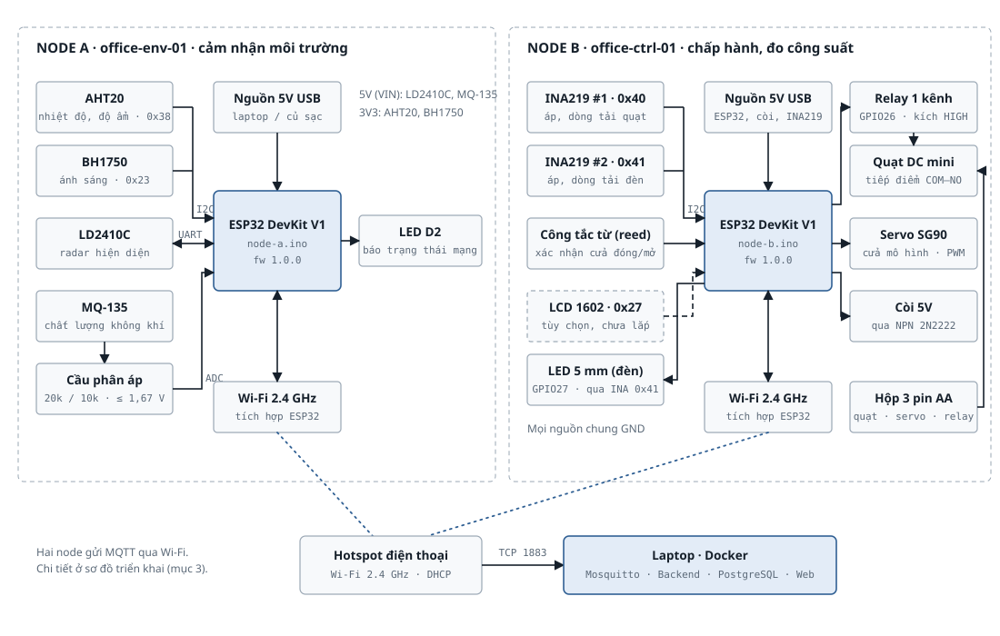
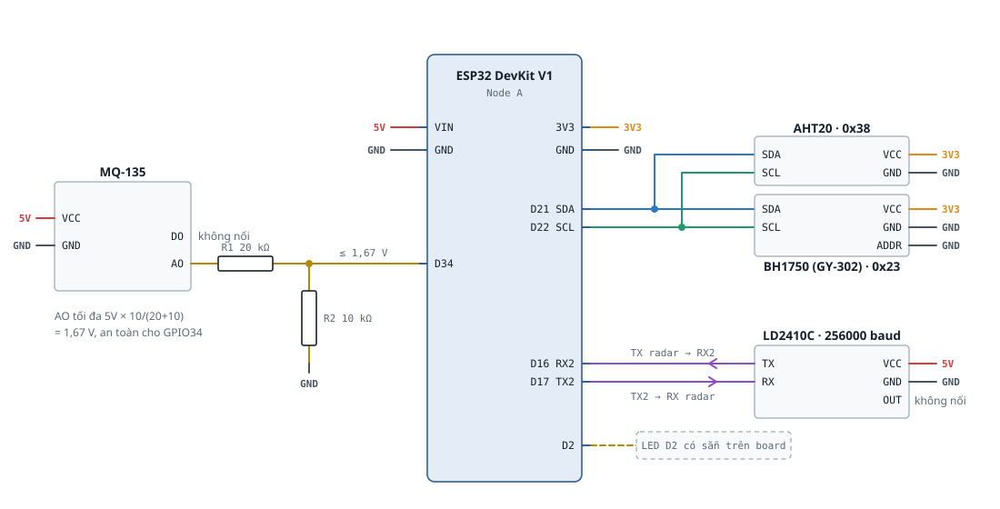
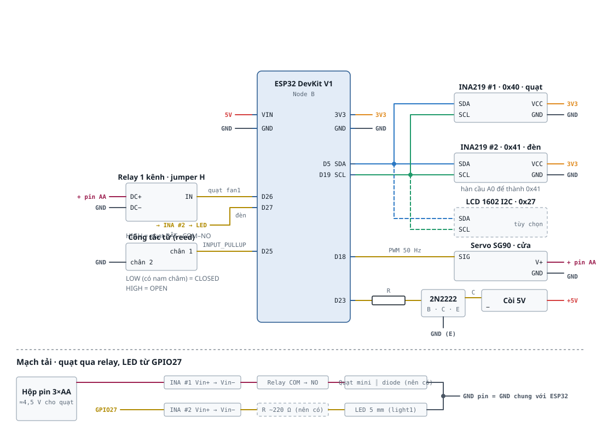
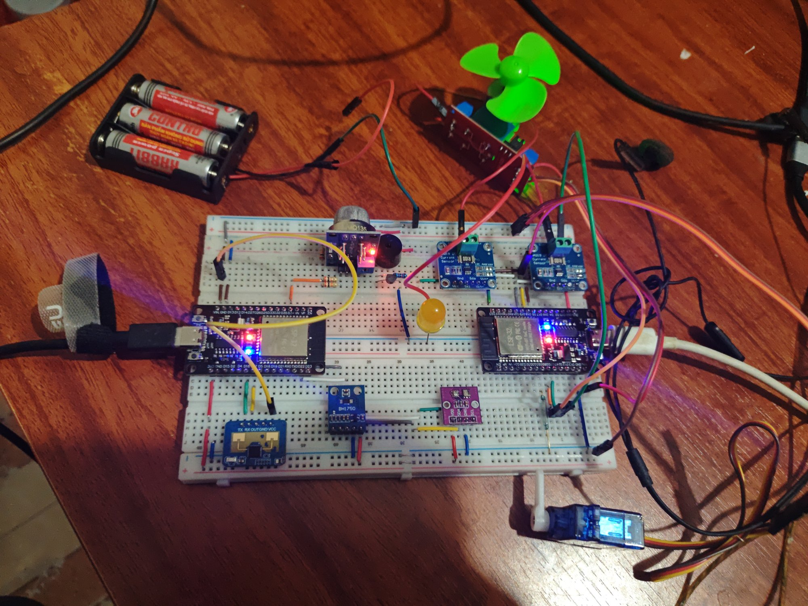

# Hardware

Phần cứng của hệ thống Phòng làm việc thông minh: danh sách linh kiện, sơ đồ nối dây, nguồn điện, cách lắp và hình ảnh
prototype. Mọi thông tin ở đây khớp với **mạch thật đã lắp và kiểm tra ngày 11/11/2026**, với firmware
(`firmware/node-a/config.h`, `firmware/node-b/config.h`) và với Contract v1.5.

```text
hardware/
├── README.md                     # file này
├── so-do-lap-rap.md              # hướng dẫn lắp: sơ đồ khối, bảng chân, sơ đồ chữ, checklist an toàn
├── diagrams/
│   ├── 1-so-do-khoi-phan-cung.svg
│   ├── 2a-so-do-ket-noi-node-a.svg
│   ├── 2b-so-do-ket-noi-node-b.svg
│   └── 3-so-do-trien-khai.svg
└── prototype/
    └── mach-that-node-a-b.jpg    # ảnh mạch thật: Node A (trái), Node B (phải) trên cùng breadboard
```

## 1. Hai node

| Node | deviceId | Vai trò | Nguồn |
| --- | --- | --- | --- |
| A | `office-env-01` | Cảm nhận môi trường: nhiệt độ, độ ẩm, ánh sáng, hiện diện, không khí | 5V USB |
| B | `office-ctrl-01` | Chấp hành và đo công suất: quạt, đèn, cửa, còi, 2 kênh đo điện | 5V USB (ESP32, còi) + hộp 3 pin AA (quạt, servo, relay) |



## 2. Danh sách linh kiện

| # | Node | Linh kiện | SL | Giao tiếp | Vai trò | Giá (VND) |
| --- | --- | --- | ---: | --- | --- | ---: |
| 1 | A, B | ESP32 DevKit V1 (chip USB CH340) | 2 | Wi-Fi 2.4 GHz | Vi điều khiển | |
| 2 | A | AHT20 | 1 | I2C `0x38` | Nhiệt độ, độ ẩm | |
| 3 | A | BH1750 (GY-302) | 1 | I2C `0x23` | Ánh sáng (lux) | |
| 4 | A | LD2410C | 1 | UART 256000 baud | Radar hiện diện, khoảng cách | |
| 5 | A | MQ-135 | 1 | ADC | Chất lượng không khí tương đối | |
| 6 | A | Điện trở 20 kΩ + 10 kΩ | 1 bộ | – | Cầu phân áp cho MQ-135 | |
| 7 | B | Relay 5V 1 kênh (jumper H/L) | 1 | GPIO | Bật/tắt quạt (`fan1`) | |
| 8 | B | Quạt DC mini | 1 | – | Tải quạt | |
| 9 | B | Hộp 3 pin AA | 1 | – | Nguồn ≈4,5 V cho quạt, servo, relay | |
| 10 | B | LED 5 mm | 1 | GPIO | Đèn mô phỏng (`light1`) | |
| 11 | B | Servo SG90 | 1 | PWM | Cửa mô hình (`door1`) | |
| 12 | B | Công tắc từ (reed switch) + nam châm | 1 | GPIO input | Xác nhận cửa đóng/mở | |
| 13 | B | Còi thụ động + transistor 2N2222 + điện trở | 1 bộ | PWM | Còi cảnh báo (`buzzer1`) | |
| 14 | B | INA219 (R shunt 0,1 Ω) | 2 | I2C `0x40`, `0x41` | Đo áp, dòng, công suất quạt và đèn | |
| 15 | – | Breadboard, dây jumper, cáp USB | – | – | Lắp ráp | |
| | | | | | **Tổng chi phí** | *(điền)* |

LCD 1602 I2C (`0x27`) có trong thiết kế ban đầu ở dạng tùy chọn, **chưa lắp**.

### Địa chỉ I2C

| Thiết bị | Địa chỉ | Node | Bus |
| --- | --- | --- | --- |
| AHT20 | `0x38` | A | SDA 21 / SCL 22 |
| BH1750 | `0x23` (chân ADDR nối GND) | A | SDA 21 / SCL 22 |
| INA219 #1 – quạt | `0x40` | B | SDA 5 / SCL 19 |
| INA219 #2 – đèn | `0x41` (đã hàn cầu A0) | B | SDA 5 / SCL 19 |

## 3. Chân GPIO

### Node A (`office-env-01`)

| Linh kiện | Chân ESP32 | Ghi chú |
| --- | --- | --- |
| AHT20, BH1750 – SDA / SCL | GPIO 21 / 22 | Chung bus I2C, cấp 3V3 |
| LD2410C TX → ESP32 | GPIO 16 (RX2) | UART2, 256000 baud; radar cấp **5V (VIN)** |
| LD2410C RX ← ESP32 | GPIO 17 (TX2) | Nối chéo TX/RX. Không dùng RX0/TX0 (cổng nạp code) |
| MQ-135 AO | GPIO 34 (ADC1) | Qua cầu phân áp **nối tiếp**: AO → 20 kΩ → GPIO34, điểm giữa → 10 kΩ → GND (tối đa ≈1,67 V); MQ-135 cấp 5V |
| LED trạng thái | GPIO 2 | LED có sẵn trên board: sáng = đã nối MQTT, nháy = đang kết nối |



### Node B (`office-ctrl-01`)

| Linh kiện | Chân ESP32 | Ghi chú |
| --- | --- | --- |
| INA219 #1, #2 – SDA / SCL | GPIO **5 / 19** | Bus I2C riêng của Node B (**không phải 21/22**); INA219 cấp 3V3 |
| Relay quạt (`fan1`) | GPIO 26 | Kích mức **HIGH** (jumper H); VCC relay từ hộp pin; quạt nối COM–NO |
| LED đèn (`light1`) | GPIO 27 | GPIO27 → INA219 #2 (Vin+ → Vin−) → LED → GND; HIGH = sáng |
| Servo SG90 (`door1`) | GPIO 18 | PWM 50 Hz (LEDC kênh 0); 0° = đóng, 90° = mở (đổi được qua cấu hình); nguồn từ hộp pin |
| Công tắc từ (`door1`) | GPIO 25 | `INPUT_PULLUP`, chân còn lại nối GND; LOW (có nam châm) = cửa đóng |
| Còi (`buzzer1`) | GPIO 23 | Qua điện trở vào cực B của 2N2222; còi thụ động phát tone 2 kHz (LEDC kênh 2) |
| LED trạng thái | GPIO 2 | Như Node A |

> GPIO 5 là chân strapping của ESP32 (phải ở mức HIGH lúc khởi động). Điện trở kéo lên của bus I2C giữ đúng mức này.



## 4. Nguồn điện

| Nguồn | Cấp cho | Ghi chú |
| --- | --- | --- |
| 5V USB (laptop hoặc củ sạc 5V), mỗi ESP32 một cổng | ESP32; từ chân VIN: LD2410C, MQ-135 (Node A), còi (Node B); từ chân 3V3: AHT20, BH1750, INA219 | Củ sạc nhanh PD/QC vẫn chỉ ra 5V với ESP32 |
| Hộp 3 pin AA (≈4,5 V) | Quạt mini (qua INA219 #1 → relay COM–NO), servo SG90, VCC relay | Tách khỏi nguồn USB |
| GND | **Tất cả nối chung**: GND hai ESP32 và cực âm hộp pin | Thiếu GND chung thì tín hiệu GPIO tới relay, servo không có mức tham chiếu |

Đường nguồn hộp pin:

```text
(+) hộp pin ─┬─ VCC relay
             ├─ V+ servo (dây đỏ)
             └─ INA219 #1 Vin+ → Vin− ─ relay COM → NO ─ quạt (+)   quạt (−) ─┐
(−) hộp pin ─────────────────────────────────────────────────────────────────┴─ GND chung
```

## 5. Lắp ráp

Thứ tự lắp và sơ đồ chữ chi tiết: [`so-do-lap-rap.md`](so-do-lap-rap.md). Các bước chính:

1. Cắm hai ESP32 lên breadboard, nối GND của hai board và cực âm hộp pin vào cùng một rail GND.
2. Node A: AHT20 và BH1750 vào 3V3, GND, D21, D22. LD2410C vào VIN (5V), GND, TX → D16, RX → D17.
3. Node A: MQ-135 vào VIN, GND; mắc cầu phân áp 20 kΩ / 10 kΩ **nối tiếp** (mỗi điện trở một hàng riêng) rồi đưa điểm giữa vào D34.
4. Node B: hai INA219 vào 3V3, GND, D5 (SDA), D19 (SCL); INA219 #2 phải hàn cầu A0 trước.
5. Node B: relay IN → D26, VCC → (+) pin, GND → GND chung, đặt jumper ở **H**; quạt đi qua INA219 #1 rồi COM–NO.
6. Node B: LED đi từ D27 qua INA219 #2; servo tín hiệu D18, nguồn từ hộp pin; công tắc từ D25–GND; còi qua 2N2222 ở D23.
7. Nạp firmware `firmware/node-a`, `firmware/node-b` (xem [`../firmware/README.md`](../firmware/README.md)).

## 6. Kiểm tra sau khi lắp

| Kiểm tra | Cách làm | Kết quả đúng |
| --- | --- | --- |
| Cảm biến Node A | Serial Monitor 115200 của Node A | Dòng `[TELEMETRY]` có `temperature`, `humidity`, `lux`, `presence`, `airRaw`, `quality` |
| MQ-135 an toàn | Đọc `airRaw` | Dưới khoảng 2100 (≈1,67 V). Gần 4095 là cầu phân áp đang sai |
| Bus I2C Node B | Telemetry Node B | Có `light1CurrentMa`, `fan1CurrentMa` (không phải `null`) |
| Cơ cấu chấp hành | Serial Monitor của Node B, gõ `fan1 ON`, `light1 ON`, `buzzer1 ON`, `door1 OPEN`, `t` | ACK `SUCCESS`; lệnh `t` in dòng điện quạt/LED tăng khi bật |
| Kết nối | LED D2 trên board | Sáng đứng = đã kết nối broker |

Kiểm thử đầy đủ trên hệ thống chạy thật: [`../tests/KICH_BAN_KIEM_THU.md`](../tests/KICH_BAN_KIEM_THU.md).

## 7. An toàn

- Chỉ dùng tải DC điện áp thấp (quạt mini chạy pin, LED). Không đấu điện lưới 220V, không dùng nguồn 12V.
- Dòng quạt đi qua tiếp điểm relay, không qua chân ESP32. Quạt nối **COM–NO** để khi ESP32 mất điện thì quạt tắt.
- LED nối thẳng GPIO 27: nên mắc điện trở hạn dòng khoảng 220 Ω (INA219 đo được khoảng 30 mA khi sáng, gần giới hạn chân GPIO).
- Khuyến nghị diode song song quạt để chống xung khi relay ngắt; thêm tụ 470–1000 µF cho servo nếu bị sụt áp.
- Firmware khởi động ở trạng thái an toàn: relay OFF, LED tắt, servo về vị trí đóng, còi tắt.

## 8. Vấn đề đã biết

| Vấn đề | Ảnh hưởng | Cách xử lý |
| --- | --- | --- |
| Nam châm chưa sát công tắc từ khi cửa ở vị trí đóng | Lệnh đóng cửa trả `FAILED` (firmware báo đúng theo cảm biến) | Đặt nam châm sát công tắc (< 1 cm, song song) ở vị trí servo 0°, hoặc chỉnh `servoCloseDeg` |
| Hộp pin AA yếu sụt áp khi quạt chạy (đo được ≈4,2 V → ≈2,2 V) | Servo quay yếu, relay có thể nhả | Thay pin mới, hoặc dùng hộp 4 pin AA |
| Dòng LED ≈30 mA (đo bằng INA219), gần giới hạn chân GPIO | Chân GPIO 27 chịu tải lớn | Mắc nối tiếp điện trở 220 Ω (hoặc tăng giá trị điện trở đang có) |

## 9. Hình ảnh

Mạch thật (Node A bên trái, Node B bên phải):



Sơ đồ khác: kiến trúc tổng thể [`../docs/Kien_truc_IoT_tong_the.png`](../docs/Kien_truc_IoT_tong_the.png),
triển khai [`diagrams/3-so-do-trien-khai.svg`](diagrams/3-so-do-trien-khai.svg),
ERD [`../database/ERD_phong_lam_viec_thong_minh.png`](../database/ERD_phong_lam_viec_thong_minh.png).
