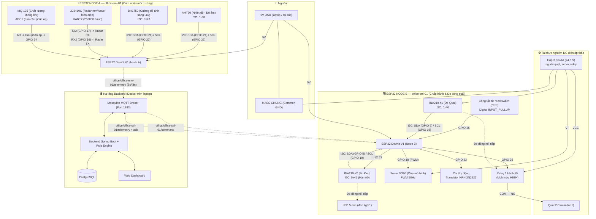

# Sơ đồ lắp ráp phần cứng — Hệ thống IoT Phòng làm việc thông minh

> **Cập nhật 11/11/2026 theo mạch thật đang chạy** (đã kiểm tra bằng firmware `firmware/node-a`, `firmware/node-b`).
> Thay đổi so với bản trước: relay **1 kênh** kích mức **HIGH** chỉ cho quạt; đèn là **LED 5 mm** ở GPIO 27; **hộp 3 pin AA** cấp nguồn cho quạt mini, servo và relay;
> I2C Node B ở **SDA 5 / SCL 19**; INA219 `0x40` đo quạt, `0x41` đo đèn; bỏ nguồn 12V, cầu chì và phần 220V.

---

## I. Sơ đồ khối tổng thể hệ thống (System Block Diagram)



---

## II. Bảng chân GPIO chính thức

### 1. Node A — Cảm nhận môi trường (`office-env-01`)

| Chân ESP32 | Thiết bị kết nối | Giao tiếp | Mức điện áp | Ghi chú kỹ thuật |
| :---: | :--- | :---: | :---: | :--- |
| **GPIO 21** | AHT20 + BH1750 (SDA) | I2C | 3.3V | Dùng chung bus I2C dữ liệu |
| **GPIO 22** | AHT20 + BH1750 (SCL) | I2C | 3.3V | Dùng chung bus I2C xung clock |
| **GPIO 16** | LD2410C (Chân TX của Radar) | UART2 (RX2) | 3.3V | ESP32 nhận dữ liệu mmWave (256000 baud) |
| **GPIO 17** | LD2410C (Chân RX của Radar) | UART2 (TX2) | 3.3V | ESP32 gửi cấu hình radar |
| **GPIO 34** | MQ-135 (Chân AO) | ADC1 | $\le 1.67\text{V}$ | **Bắt buộc qua cầu phân áp nối tiếp** (R1=20kΩ trên, R2=10kΩ xuống GND) |
| **GPIO 2** | LED trên board | Digital OUT | 3.3V | Firmware báo trạng thái kết nối: sáng = MQTT ok, nháy = đang kết nối |
| **3.3V** | VCC của AHT20, BH1750 | Nguồn | 3.3V | Dòng cảm biến I2C thấp |
| **5V (VIN)** | VCC của LD2410C, MQ-135 | Nguồn | 5V | MQ-135 cần 5V sấy heater; LD2410C ăn 5V |
| **GND** | Mass chung tất cả cảm biến | GND | 0V | Nối về chân GND ESP32 |

---

### 2. Node B — Chấp hành & Đo công suất (`office-ctrl-01`)

| Chân ESP32 | Thiết bị kết nối | Giao tiếp | Mức điện áp | Ghi chú kỹ thuật |
| :---: | :--- | :---: | :---: | :--- |
| **GPIO 26** | Relay 1 kênh (Quạt `fan1`) | Digital OUT | 3.3V | Kích mức cao (jumper H): HIGH = quạt bật |
| **GPIO 27** | LED 5 mm (Đèn `light1`) qua INA219 #2 | Digital OUT | 3.3V | HIGH = sáng; nên có điện trở hạn dòng ~220Ω |
| **GPIO 18** | Servo SG90 (Dây cam - PWM) | PWM (LEDC kênh 0) | 3.3V | Tần số 50Hz (0° = đóng, 90° = mở cửa; đổi được qua config) |
| **GPIO 25** | Công tắc từ reed switch (Cửa) | Digital IN | 3.3V | `INPUT_PULLUP` (Đóng = LOW, Mở = HIGH), chống dội 50 ms |
| **GPIO 23** | Còi thụ động | PWM (LEDC kênh 2) | 3.3V | Qua điện trở vào cực B của 2N2222; phát tone 2 kHz |
| **GPIO 5** | INA219 #1 + #2 (SDA) | I2C | 3.3V | Bus I2C của Node B; chân strapping, điện trở kéo lên I2C giữ HIGH khi khởi động |
| **GPIO 19** | INA219 #1 + #2 (SCL) | I2C | 3.3V | Bus I2C của Node B |
| **3.3V** | VCC của INA219 #1 & #2 | Nguồn | 3.3V | Cấp cho chip đo |
| **5V (VIN)** | Còi (qua 2N2222) | Nguồn | 5V | Từ cổng USB của ESP32 |
| **Hộp 3 pin AA** | VCC Relay, V+ Servo, nguồn Quạt | Nguồn ngoài | ≈4,5V | GND hộp pin nối chung GND ESP32 |
| **GND** | Mass chung | GND | 0V | **Nối chung GND giữa ESP32 và hộp pin quạt** |

---

## III. Sơ đồ mạch nguyên lý đấu nối chi tiết (Wiring Diagram)

### 1. Mạch Node A

```
                    ESP32 DevKit V1 (Node A)
           ┌────────────────────────────────────────┐
           │ 3V3 ────┬───── AHT20 VCC               │
           │         └───── BH1750 VCC              │
           │                                        │
           │ GPIO 21 (SDA) ─┬─── AHT20 SDA (0x38)   │
           │                └─── BH1750 SDA (0x23)  │
           │                                        │
           │ GPIO 22 (SCL) ─┬─── AHT20 SCL          │
           │                └─── BH1750 SCL         │
           │                                        │
           │ GPIO 16 (RX2) ◄──── LD2410C TX         │
           │ GPIO 17 (TX2) ─────► LD2410C RX        │
           │                                        │
           │                  MQ-135 AO (0~5V)      │
           │                         │              │
           │                     [R1 = 20kΩ]        │
           │                         │              │
           │ GPIO 34 (ADC1) ◄────────┤ (Max 1.67V)  │
           │                         │              │
           │                     [R2 = 10kΩ]        │
           │                         │              │
           │ GND ────────────────────┴── Tất cả GND │
           │                                        │
           │ 5V (VIN) ─── Cấp 5V cho LD2410C & MQ135│
           └────────────────────────────────────────┘
```

---

### 2. Mạch Node B

```
                    ESP32 DevKit V1 (Node B)
           ┌────────────────────────────────────────┐
           │ GPIO 26 ──────── IN (Relay 1 kênh, H)  │
           │ GPIO 27 ──────── INA219 #2 Vin+        │
           │                  Vin- ── LED (+) ── LED (-) ── GND
           │                                        │
           │ GPIO 18 (PWM) ── Dây Cam (Servo SG90)  │
           │                  Đỏ -> (+) pin AA, Nâu -> GND
           │                                        │
           │ GPIO 25 ──────── 1 chân Công tắc từ    │
           │                  (Chân còn lại vào GND)│
           │                                        │
           │ GPIO 23 ──[R]─── Base NPN (2N2222)     │
           │                  Collector -> Cực (-) Còi
           │                  Cực (+) Còi -> 5V     │
           │                  Emitter -> GND        │
           │                                        │
           │ GPIO 5 (SDA) ──┬── INA219 #1 SDA (0x40)│
           │                └── INA219 #2 SDA (0x41)│
           │                                        │
           │ GPIO 19 (SCL) ─┬── INA219 #1 SCL       │
           │                └── INA219 #2 SCL       │
           │                                        │
           │ 5V (VIN) ─────── Cực (+) Còi           │
           │ GND ──────────── GND chung (cả hộp pin)│
           └────────────────────────────────────────┘

  NGUỒN HỘP 3 PIN AA (≈4,5 V):
  (+) Hộp pin ─┬── Relay VCC
                ├── Servo V+ (dây đỏ)
                └── INA219 #1 (Vin+) -> (Vin-) ── Relay COM ── NO ── Quạt mini (+)
                                                                       Quạt mini (-) ─┐
  (-) Hộp 3 pin AA ───────────────────────────────────────────────────────────────────┴── GND chung

  *Khuyến nghị: mắc 1 diode (vd. 1N4007) song song ngược cực tại 2 đầu quạt để dập xung khi relay ngắt.
```

---

## IV. Bảng địa chỉ I2C

| Thiết bị | Địa chỉ I2C | Gắn tại Node | Mục đích |
| :--- | :---: | :---: | :--- |
| **AHT20** | `0x38` | Node A (SDA 21 / SCL 22) | Đo Nhiệt độ & Độ ẩm không khí |
| **BH1750** | `0x23` | Node A (SDA 21 / SCL 22) | Đo Cường độ ánh sáng Lux |
| **INA219 #1** | `0x40` | Node B (SDA 5 / SCL 19) | Đo áp, dòng, công suất tải **Quạt** |
| **INA219 #2** | `0x41` (hàn A0) | Node B (SDA 5 / SCL 19) | Đo áp, dòng, công suất tải **Đèn LED** |
| **LCD 1602** (Tùy chọn, chưa lắp) | `0x27` | Node B | Màn hình hiển thị trạng thái tại chỗ |

---

## V. Checklist an toàn (Theo NFR-10)

1. Hệ thống **không dùng điện lưới 220V và không dùng nguồn 12V**. Tải là quạt mini chạy hộp 3 pin AA (≈4,5 V) và LED 5 mm.
2. Mỗi ESP32 lấy 5V qua cổng USB (laptop hoặc củ sạc 5V); còi lấy 5V từ chân VIN, cảm biến I2C lấy 3V3. **Hộp 3 pin AA cấp riêng cho quạt, servo và relay.**
3. **Tất cả các nguồn (USB 5V của 2 ESP32, hộp pin) phải nối chung GND**, nếu không tín hiệu GPIO tới relay và servo sẽ không có mức tham chiếu.
4. Pin yếu sẽ sụt áp khi quạt chạy (đã đo: từ ≈4,2 V xuống ≈2,2 V lúc quạt bật), làm servo yếu hoặc relay nhả. Thay pin mới trước khi demo.
5. Dòng quạt đi qua tiếp điểm relay, không đi qua chân ESP32. Quạt nối **COM–NO** để khi ESP32 mất điện thì quạt tắt.
6. LED nối trực tiếp GPIO 27: nên mắc điện trở hạn dòng ~220Ω để dòng dưới 20 mA (INA219 đo được khoảng 31 mA khi LED sáng, gần giới hạn của chân GPIO).
7. Khuyến nghị diode song song quạt; nếu servo làm sụt áp khi quay, thêm tụ 470–1000µF sát chân nguồn servo.
8. Firmware khởi động ở trạng thái an toàn: relay OFF, LED tắt, servo về vị trí đóng, còi tắt.
